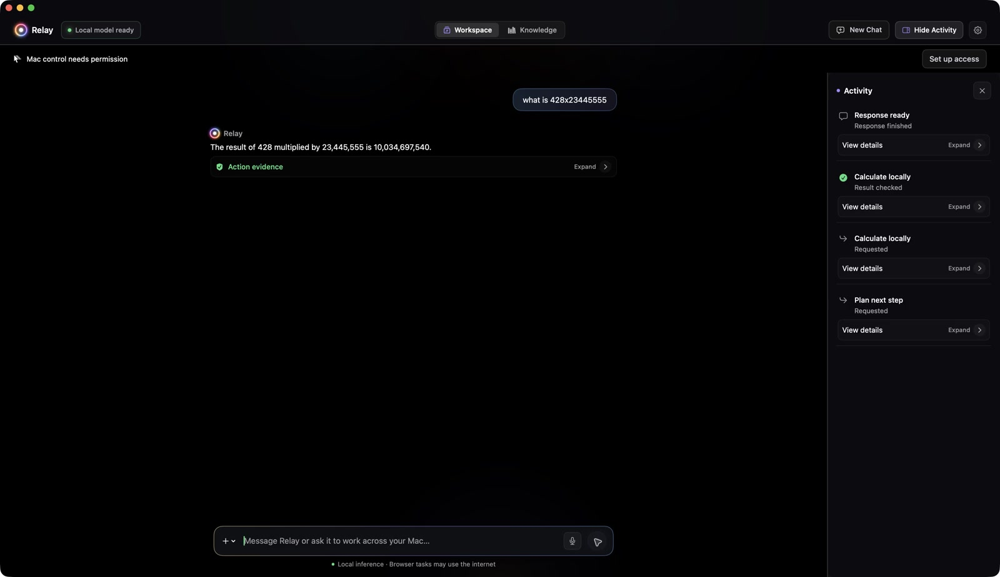
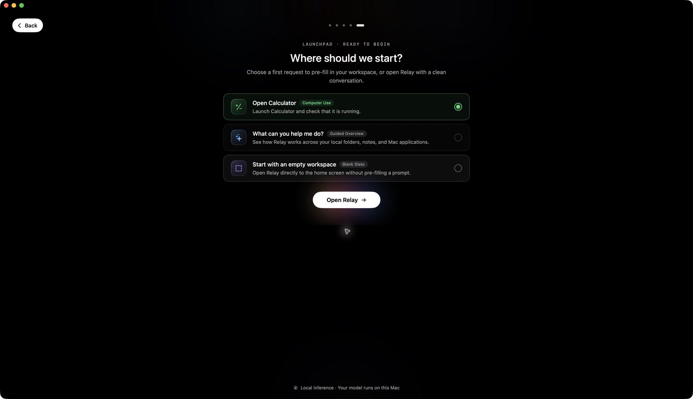

# Relay for macOS

A native SwiftUI personal assistant with embedded **LiteRT-LM + local Gemma**, a product-owned tool loop, real macOS actions, explicit context grants and verified tool results. This is an early executable alpha, not the HTML design specimen.

## At a glance

- Native macOS chat interface built with SwiftUI.
- Local Gemma inference through Google's LiteRT-LM; no hosted inference account required.
- Optional ChatGPT reasoning for workspace and Mac app tasks through an existing Codex CLI sign-in.
- Desktop-control integration with Vercel Labs' `agent-desktop`, alongside Relay's native Accessibility tools.
- Explicit file and folder grants, inspectable activity, and checked tool outcomes.
- Early alpha: build from source; desktop workflows and hardware support are still being qualified.

## Product videos

Real recordings from the native development build: local arithmetic with checked results, and the five-stage onboarding flow. These are early-alpha demonstrations; the local build includes runtime changes not yet published in this repository.

| Local arithmetic | Onboarding |
| --- | --- |
| [](docs/demos/arithmetic.mp4) | [](docs/demos/onboarding.mp4) |

[Capture details and limitations](docs/demos/README.md).

## Built with

| Component | Role |
| --- | --- |
| Swift + SwiftUI | Native macOS app and interface |
| [Google LiteRT-LM](https://github.com/google-ai-edge/LiteRT-LM) | Embedded local inference runtime |
| Gemma | Separately downloaded local model in `.litertlm` format |
| [Vercel Labs agent-desktop](https://github.com/vercel-labs/agent-desktop) | Desktop-control CLI, native helper, and C FFI integration |
| macOS Accessibility + AppKit | Native observations, app interaction, and independent checks |

Thanks to the teams behind these projects. Relay is an independent project; these credits do not imply endorsement.

## Build and run

Requires an Apple silicon Mac with macOS 15+ and Xcode 26+ / Swift 6.2+. The app’s setup check requires at least 8 GB of unified memory; 16 GB or more is recommended. Model and desktop compatibility depend on the Mac, backend, and apps used.

```bash
git clone https://github.com/SEAbdulbasit/Relay.git
cd Relay
./Scripts/build-app.sh
open build/Relay.app
```

Open `Package.swift` in Xcode to edit/debug. No cloud account or inference server is required. First build downloads the pinned official LiteRT-LM macOS binary. The 13-file Swift wrapper is vendored verbatim with Apache-2.0 license and exact upstream commit in `Vendor/LiteRTLM/UPSTREAM.md`; this avoids fetching the upstream repository's large model/history objects. The vendored source commit and official binary checksum pin the dependency. A local build is ad-hoc signed; production distribution needs a developer identity, hardened-runtime qualification and notarization.

### Desktop-control dependency

The repository includes `agent-desktop` 1.0.2 binaries and its Apache-2.0 license under `Vendor/agent-desktop/`. The build script bundles the CLI, macOS helper, and FFI library into Relay.app. To fetch binaries for your Mac's architecture or refresh this version before building:

```bash
./Scripts/update-agent-desktop.sh v1.0.2
./Scripts/build-app.sh
```

The updater downloads official Vercel Labs release archives and verifies their published SHA-256 checksums. Accessibility permission must be granted by the user in macOS System Settings. Integration does not establish support for every application or workflow.

## Set up a model

1. Open Relay. The first-run assistant checks this Mac and explains local inference. Reopen it later from Settings → Run setup assistant.
2. Download the pinned recommended Gemma package (2.59 GB), check an existing downloaded package, or import a **Gemma `.litertlm` package with native tool-call support**. Downloads are explicit and display progress and SHA-256 verification. Paused downloads can resume from verified chunks when the host supports range requests; whole-file transfers restart. GGUF/Ollama packages are not compatible. For workspace and Mac app tasks, you can also choose **Use ChatGPT** with an existing Codex CLI sign-in and skip the download.
3. Load and check the model. Relay initializes the embedded engine and requests a side-effect-free structured-call probe. A saved model path does not count as a loaded model after relaunch. Settings lists locally installed catalog packages; Relay verifies the selected package before loading it. CPU is the default; GPU availability depends on the package and runtime.
4. Review Accessibility access and optionally run the independent local control fixture. You can skip computer control and add selected files later; no broad disk permission is requested.
5. Choose a first request. Setup puts it in chat without executing it. You send it when ready. Setup can be dismissed and reopened without deleting conversation history.

Models stay outside the app bundle. The app uses native URLSession for the explicit recommended-model download, validates byte count and SHA-256, and refuses to overwrite an unknown existing model. The development alternative downloads the same pinned public Gemma 4 E2B package using `python3 Scripts/download-gemma.py`, checks the published SHA-256 and records provenance under `~/Library/Application Support/Relay/Models/`. No account, hosted inference or license click-through is required for that public Apache-2.0 artifact. The chat probe checks native tool calls. Image inspection separately checks that the selected package accepts image input. LiteRT-LM's non-streaming API is deliberate: the pinned SDK streaming callback can auto-execute tools despite its flag. Native tools in Relay are schema-only at the SDK layer, and only Relay's executor dispatches actions.

## Use it

Speak naturally in one conversation. The local model chooses available tools. Relay validates their arguments and resolves browser requests before presenting them for review.

- “Open VLC.” App launch is checked using NSWorkspace process state.
- Attach a text document or text-based PDF, then ask for a summary.
- Add a folder and explicitly enable writing in Context before asking Relay to create a Markdown, text or CSV file. Existing-file replacement requires review; bytes are read back independently.
- “Fill the form in Safari using this attached document, and leave it unsubmitted.” Grant Accessibility to Relay in System Settings when requested. The app must expose accessible editable controls. Each text entry is read back, fresh observations are required after mutations, secure controls are excluded, and final controls are left for the user to activate manually.
- Attach a media file and ask to open it in VLC/QuickTime. Known exact playback buttons can be used without repeated confirmation. Launching a player is never labeled as verified playback.

Ordinary scoped observations, app opening, new-file creation, supported scrolling and text entry can run autonomously. URL navigation and existing-file replacement show a review bound to the exact request and state captured before review. Generic UI presses, including sending, publishing and final form submission, remain manual until destination/content binding is qualified. These conservative review rules intentionally exceed the final product's intended intervention rate while app-specific capabilities are qualified. Obvious financial, security and destructive controls are excluded, not unlocked by approval.

During execution you can send a follow-up instruction. Relay cancels old planning, waits for any in-flight tool to settle, invalidates approvals and resumes with the new constraint. **Stop** blocks new dispatch immediately; an in-progress operation may finish. Resume asks the model to refresh state; stale UI references cannot be reused. Crash recovery never replays unfinished mutations automatically.

Knowledge lets you read selected indexed sources and create or edit local Markdown notes in folders. Use **Add link** in a note to connect people and projects to their source documents. Relay can generate highlights with source provenance, refresh changed sources, and index a WhatsApp text export you select. Settings → Knowledge lets you share selected authored notes with a local MCP client or export an encrypted portable archive.

Settings → Sources can capture the selected items in Apple Notes or Mail, read a selected Messages backup conversation or WhatsApp text export, and connect to a user-supplied MCP endpoint for reviewed reads. You can ask about these results locally without adding them to saved chat. Notes and Mail capture require macOS Automation consent for those apps. Messages backups include supported plain-text rows only.

In the workspace attachment menu, choose **Inspect Image or Window**. Select a still image or use the macOS picker to select one window, then ask a question. Relay shows a preview and runs local image analysis with no tools. The image and answer are cleared when the panel closes.

Settings → Sidekick controls the notch and its shortcuts. Tap the selected modifier once to open or close Sidekick, or twice at the end of a supported multiline reply field to draft there. Double Tap checks that the field and its content are still current before editing. You can select a separate local drafting model and approve editable style suggestions from examples in Settings → Memory.

Enable **Open Sidekick on every display** for a passive entry handle on each display. With **Hold to dictate**, press and hold a handle to speak, then release to review an editable transcript. **Release the handle to send** is a separate opt-in: only a finalized, unchanged local transcript with the same originating app can start a task. Stop, cancellation, edits and ChatGPT mode retain explicit review.

Use **Task → Summarize** for the chosen Chrome/Safari page or a selected text-based PDF. Up to four independent readers share one local inference queue. Each reader shows capture coverage; closing it clears its source and result. Optional Summarize/Proofread shortcuts live in Settings → Sidekick. Settings (⌘,) and Stop (⌘.) retain their normal shortcuts.

In Knowledge, explicitly linked `[[Person:…]]` and `[[Project:…]]` entities can produce a reviewed **Source brief** from exact quoted excerpts across two to eight linked sources. Saving creates a separate editable historical snapshot. It never silently merges people, invents cross-source facts or replaces an existing note.

Activity shows actual tool evidence, errors and uncertain effects. The model response is accompanied by software-generated checked outcomes. A “finished” run is not a claim that an arbitrary user goal or an evaluation suite has passed.

## Boundaries

- Gemma is the default and works without an account. For this session, opt in under **Settings → Models → ChatGPT via Codex CLI → Use ChatGPT**. Relay reuses an existing ChatGPT login from a compatible local Codex CLI. No Relay account, API key entry, or automatic hosted fallback is involved.
- In ChatGPT mode, workspace requests and action status go to OpenAI. Relay asks before sending the displayed app list or excerpt from an app or page. Relay runs the actual Mac tools and applies its normal action reviews. Earlier conversations, saved memory, indexed sources, calendar, files, background drafts, and image analysis stay with the local model. Follow-up workspace requests in ChatGPT mode start with fresh context.
- User-requested websites may be opened after destination review; the browser may use the internet and an existing session. Network dependence differs from local inference.
- Files are limited to explicitly granted paths, resolved against symlink escape. No broad disk scan.
- Text/PDF extraction and output are bounded. Selected images and the first three pages of a scanned PDF can use local OCR. Review the recognized text for errors.
- Exact requests such as **Open Calculator** and **What is 48 × 37?** can run locally without a model and return verified results. Multi-step requests use the selected planner. Accessibility control requires macOS permission. Relay can inspect or focus a specific window, enter multiline text, and verify supported scroll position changes.
- Native control adapters support reviewed named checkboxes, disclosure triangles, dropdowns, radio choices and read-only table row selections. A row selection does not open or activate it. Unsupported, mixed, ambiguous, consequential and permission-changing controls refuse. Browser and native observations bind the selected app process; stale references cannot migrate to another profile.
- Morning Brief can refresh explicitly selected local sources, include a session-only agenda from selected calendars, prepare up to two local drafts, and notify you when it is ready. Explicit deadlines affect ordering, and exact source copies share review decisions. Drafts can survive relaunch while the original evidence is current. Scheduled work can resume within its original time window after sleep, a quit, or a power interruption. Relay can show a one-time macOS wake command and verify its presence in the system queue. Applying it requires macOS authorization, and actual wake depends on the hardware and power state.
- Sidekick opens from the Mac notch, Task menu, or menu bar. It shows the active workspace provider, progress, approvals, and results. Select the current app in the notch to include it in one local task. If macOS grants screen capture access, Relay can use local OCR on that exact window when accessible text is missing. Raw recognition output is available only during that task. You can also choose a window yourself with the image and window picker.
- Relay can stage an approved local file path in a supported native attachment chooser and verify what it entered. Choose the file yourself to complete the handoff.
- Apple Mail workflows use an existing Mail account and separate macOS Automation access. Relay can create a reviewed plain-text draft, capture its current sender and recipients, and submit it only after an expiring exact-content approval. A changed draft invalidates that approval. An uncertain send is blocked from replay, and Mail acceptance is reported separately from recipient delivery. Attachments in this workflow require a manual handoff.
- Selected Notes and Mail snapshots can refresh automatically while Relay runs. This opt-in rereads the original captured item references, excludes newly locked items, and clears unavailable or revoked scope. It does not follow a changed selection or a restarted source app. Content and refresh preferences remain session-only.
- Sidekick’s Text actions menu summarizes or proofreads an explicit selection using the local model in a separate temporary window. Proofreading shows original and corrected text before a one-use native field replacement. Changed targets, browser fields and unsupported formatting use copying instead. Source text and results stay out of chat history and saved state.
- Document readers capture at most 8,000 UTF-8 bytes of loaded static browser text or selected PDF excerpts. PDFs require a readable text layer and are limited to 10 MB and 20 pages. The source is pinned before asynchronous work; changed PDF identity or removed access clears retained output. A browser with no exposed accessible document may refuse until its content is ready. Video transcripts, combined image/text capture and same-chat continuation are not provided by this route.
- Settings → System contains startup and update controls. Update checks use the public GitHub release feed without a Relay account. Downloads open the validated release page. Installing an update depends on a published release and the archive’s signing and notarization.
- Purchases, account administration, automatic password entry, unrestricted shell access, and a mobile companion are unavailable.
- No persistent screenshots or telemetry. Conversation, activity, explicit memory and grants are stored locally in `~/Library/Application Support/Relay/state.json` with user-only permissions. Clear Conversation removes conversation/activity; memory and context are removable separately. Selected originals stay in place. No task content becomes memory automatically.
- File/model loading and native inference can fail or run slowly. Task loop and model inference have budgets; already-applied changes are not rolled back.

## Verification

```bash
swift test
# Optional native CPU initialization test using a compatible test fixture:
RELAY_LITERT_TEST_MODEL=/absolute/path/test.litertlm swift test
```

Tests cover action dispatch after Stop, false model narratives, interrupted-state restore, schema/scope/symlink checks, review invalidation, file/PDF readback and native model-message handling. [Current parity status and remaining gaps](docs/parity-status.md) distinguish implemented paths from runtime qualification. Release targets in `planning/` are future gates, not achieved performance claims.

## Accessibility interaction checks

See [current workflow verification and reproduction steps](docs/verification-2026-11-07.md). Settings → Permissions → **Run accessibility check** operates bundled synthetic windows. It checks text entry, exact window focus, scrolling, a reviewed Apply click, stale and disabled control rejection, review drift, and queued-click invalidation. The test needs macOS Accessibility permission and uses an independent fixture to verify effects.

`search_finder` opens Finder and enters the requested query through its visible search field. The entered query and any visible exact filename evidence are reported separately. The desktop integration test checks the visible query; model planning is tested separately.

Benign named AXButton clicks use complete window/editable-field review binding. Incomplete, secure, and oversized contexts refuse. Generic final submission, sends, publication, and consequential controls remain manual. The separate Apple Mail workflow binds its own exact displayed review to each draft and send.


## Repository layout

| Path | Contents |
| --- | --- |
| `Sources/Relay/` | SwiftUI app, local model loop, tool execution, and desktop bridge |
| `Sources/RelayAccessibilityFixture/` | Native fixture for Accessibility checks |
| `Tests/` | Swift test suite |
| `Scripts/` | Build, dependency updates, model download, and release tooling |
| `Vendor/` | Third-party runtime wrappers and desktop-control dependencies |
| `Resources/` | App metadata, icons, and third-party notices |
| `website/` | Static project website |
| `planning/` | Product plans, design artifacts, and qualification notes |
| `e2e_tests/` | Additional Python validation scenarios |
| `TestWorkspace/` | Small manual verification fixtures |

## Contributing

Issues and pull requests are welcome. Include your macOS version, Mac architecture, model package, reproduction steps, and expected versus observed behavior. Remove personal conversation content and file paths from logs before sharing them. For code changes, run `swift test` and describe any manual checks; desktop integration checks require a Mac and user-granted permissions.

## Third-party licenses

LiteRT-LM and Vercel Labs' `agent-desktop` include their Apache-2.0 licenses in `Vendor/`. See [third-party notices](Resources/ThirdPartyNotices.txt) and [LiteRT-LM provenance](Vendor/LiteRTLM/UPSTREAM.md). Model packages are downloaded separately and carry their own publisher's terms. This repository currently does not declare a license for Relay's original code.
