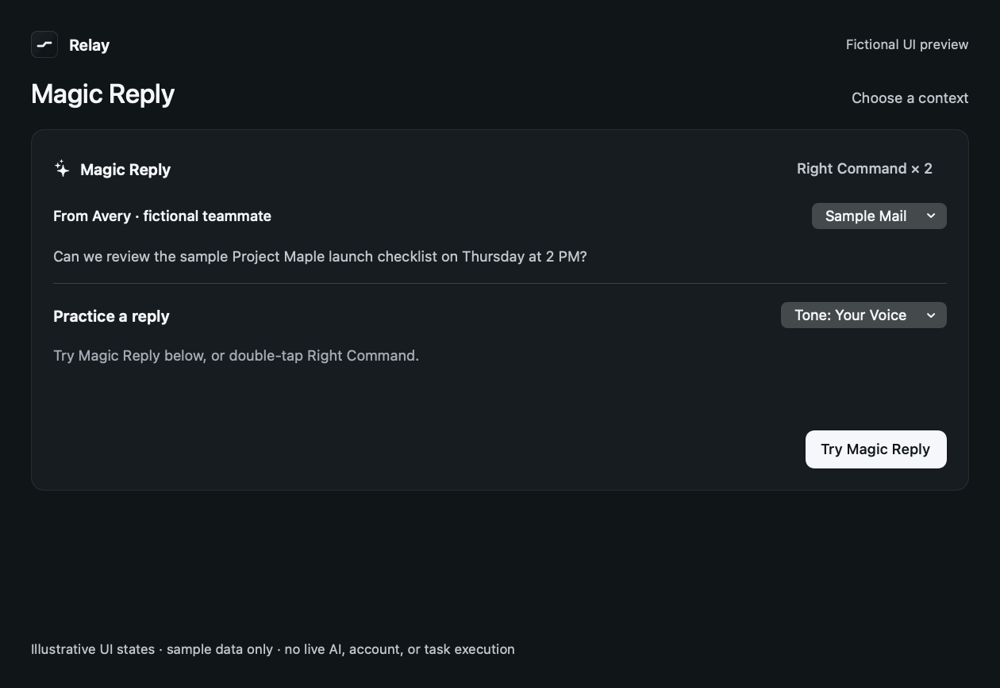
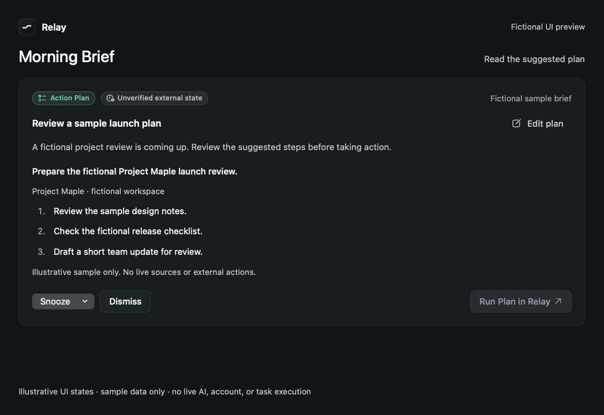
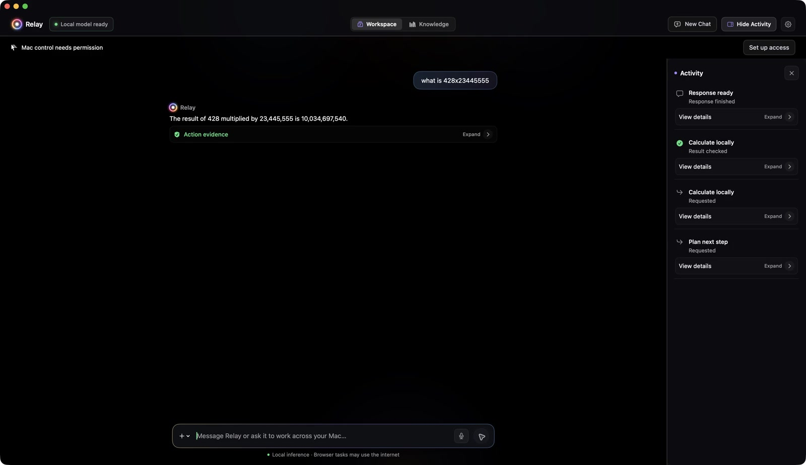
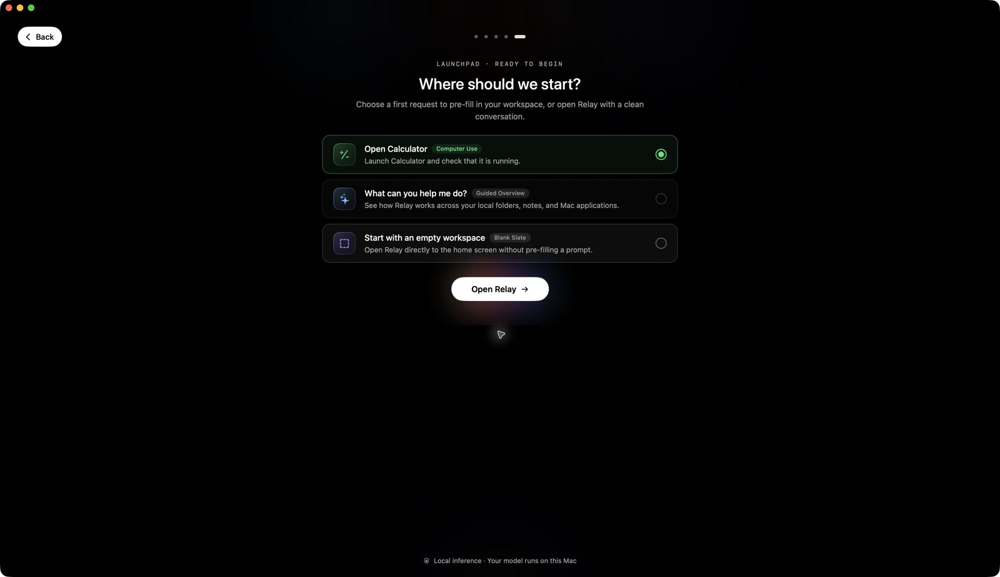

# Product demos

## Fictional UI walkthroughs — 22 November 2026





These GIFs are state sequences rendered from real SwiftUI components: the same `MagicReplyPracticeCard` used in onboarding, and `ProactiveMorningCardView` used by Morning Brief. Magic Reply moves from an incoming sample message to a sample unsent reply and a shorter tone. Brief shows an initial fictional plan and a shorter reviewed version.

They are **illustrative component previews**, not desktop recordings or live AI/task executions. Frame holds are presentation timing, not response-time measurements. The content is fixed fictional Project Maple data. Plan actions are disabled and external state is explicitly unverified. No messages are sent, no plan runs, and no real calendar, account or source is accessed.

### Data provenance and regeneration

The renderer constructs only store-free presentation components from literals in [PublicDemoCaptureTests.swift](../../Tests/RelayTests/PublicDemoCaptureTests.swift). It does not construct `AssistantStore`, load a vault or account, read local user files, capture the desktop, or use the screenshots attached in chats. GIF/PNG exports contain rendered pixels and playback metadata only. The existing media below are separate historical captures.

```bash
RELAY_RENDER_PUBLIC_DEMOS=1 RELAY_PUBLIC_DEMO_DIR="$PWD/docs/demos" \
  swift test --filter PublicDemoCaptureTests
```

The opt-in export produces the two GIFs plus PNG posters. It is skipped during ordinary test runs. Each sequence is 1260 × 868 pixels, with no audio.

## Earlier native recordings — 1 November 2026

The following clips show an older native development interface. They are demonstrations, not a release or a claim of Sentient feature parity.

## Local arithmetic

[](arithmetic.mp4)

A real request, `what is 428x23445555`, is interpreted by local Gemma. Relay calls its local arithmetic tool, displays checked activity, and answers **10,034,697,540**. No Calculator.app interaction is claimed. The visible Mac-control permission warning does not prevent this local calculation.

## Onboarding

[](onboarding.mp4)

The five setup stages: introduction, privacy example, local model, Mac access, and first task. The model is already installed; no download is depicted. The privacy workflow is an example, not a live Calculator run. Mac access is shown in its actual permission-needed state.

## Capture and playback

- Silent H.264 MP4, 1600 × 924, with no audio track.
- Actual Relay-window frames captured through Computer Use, roughly 2–3 frames per second, encoded at 30 fps with held frames. This is a low-frame-rate screencast, not a 30 fps motion capture.
- Original elapsed intervals are preserved; a short final hold is added. No response time is shortened and no result is fabricated.
- Only Relay is captured. No webcam, microphone, other-app windows or private account content is included.
- Raw frames and timing manifests stay in ignored `raw/`; published MP4s and posters are reviewed derivatives.
- These historical recordings do not depict the current onboarding and Brief design.

Open the linked MP4 to play it if GitHub displays a file preview instead of an inline player.
