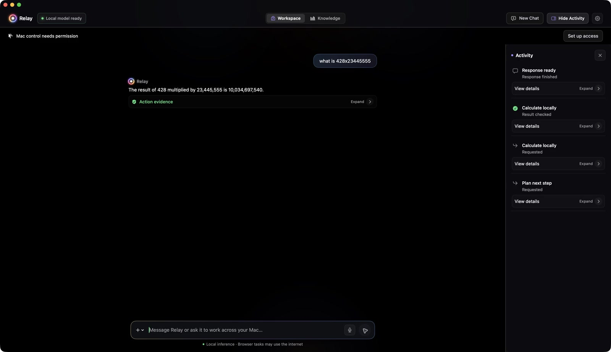
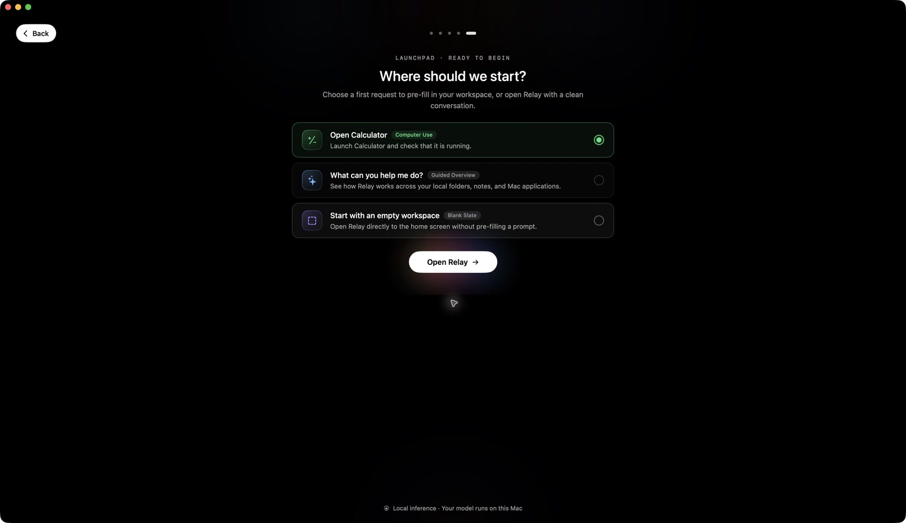

# Product demos

Recorded from the native Relay development app on 1 November 2026. These clips show a local working build ahead of the repository’s current runtime source; they are demonstrations, not a release or a claim of Sentient feature parity.

## Local arithmetic

A real request, `what is 428x23445555`, is interpreted by local Gemma. Relay calls its local arithmetic tool, displays checked activity, and answers **10,034,697,540**. No Calculator.app interaction is claimed. The visible Mac-control permission warning does not prevent this local calculation.

## Onboarding

The five setup stages: introduction, privacy example, local model, Mac access, and first task. The model is already installed; no download is depicted. The privacy workflow is an example, not a live Calculator run. Mac access is shown in its actual permission-needed state.

## Capture and playback

- Silent H.264 MP4, 1600 × 924, with no audio track.
- Actual Relay-window frames captured through Computer Use, roughly 2–3 frames per second, encoded at 30 fps with held frames. This is a low-frame-rate screencast, not a 30 fps motion capture.
- Original elapsed intervals are preserved; a short final hold is added. No response time is shortened and no result is fabricated.
- Only Relay is captured. No webcam, microphone, other-app windows or private account content is included.
- Raw frames and timing manifests stay in ignored `raw/`; published MP4s and posters are reviewed derivatives.
- These media-only changes do not publish the other uncommitted runtime work in the local checkout.

Open the linked MP4 to play it if GitHub displays a file preview instead of an inline player.
